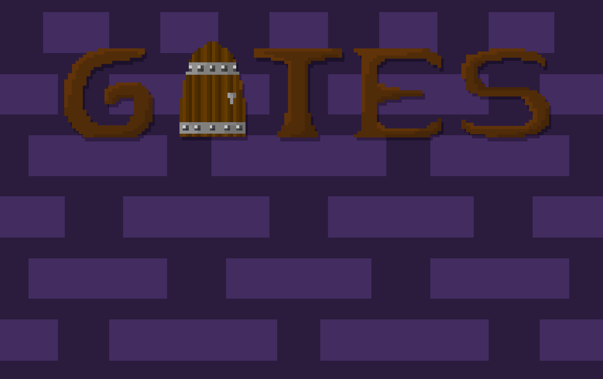

# GATES
### 2D Infinite Dungeon Crawler

  

## Overview
**Who knows how you got here?** All you can do now is fight, fight, fight! Gates is a 2D top-down dungeon crawler made in **Unity (C#)** featuring autonomous enemy path-finding, custom sprite animations, and an original soundtrack.

This repo only contains the main **C#** scripts used for the game and does not include any art assets, music, or sound effects (to keep the repo lightweight!)

## General Gameplay
**GATES** is a top down game where you battle through infinite and random set of rooms full of enemies and spawners. As the player continues, there is a sense of difficulty progression as the rooms get bigger and more dangerous/lethal. After the player defeats all enemies and spawners in a room, they are rewarded with a safe room which either has a chest full of useful items or an **Upgrade Totem** to spend nuggets on useful upgrades to their gear. Here is a general gameplay video (compressed to 720p 30fps to be under 10MB)

https://github.com/AayanNaqvi/GATES-Core-Systems/blob/main/Media/GATES%20Silent%20Gameplay-compressed.mp4

